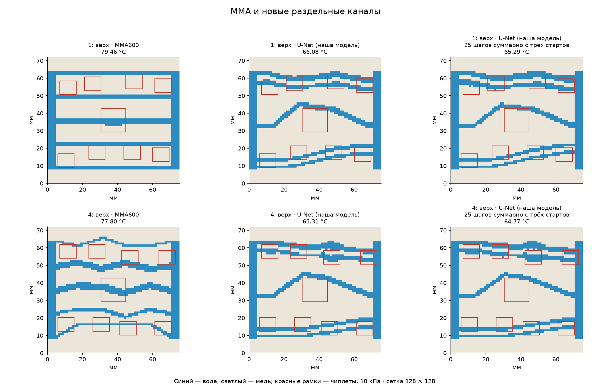

# WaveForge

### Нейросеть, которая рисует водяное охлаждение для многочиплетных процессоров

[Русский](#russian) · [English](#english) · [3D-интерфейс / Demo](#demo) · [Модели](models/) · [Результаты](results/)

<a id="russian"></a>

## Что это

Над процессором стоит медная пластина, внутри которой течёт вода. От того, как проложены каналы, зависит, насколько нагреется кристалл. WaveForge подбирает эти каналы сам: мы задаём, где стоят чиплеты и сколько ватт выделяет каждый, а программа выдаёт готовую карту каналов. Процессор взят по образцу AMD EPYC: 8 вычислительных чиплетов, I/O-кристалл в центре, 360 Вт.

Правила игры фиксированные. Вода занимает ровно 25 % площади слоя, насос ограничен, каналы должны быть связными. В этих рамках нужно, чтобы самая горячая точка кремния была как можно холоднее.



На картинке синим показана вода, светлым медь, красными рамками чиплеты.

## Коротко о результатах

| | Что получилось |
|---|---|
| Скорость | Быстрый режим выдаёт конструкцию за ~10–30 мс. MMA600 на той же видеокарте думает ~65 с, так что выходит примерно в 2100–2700 раз быстрее |
| Против обычных прямых каналов | Перегрев кремния в медиане ниже на ~21 % (77,6 → 66,7 °C) на 64 новых задачах, ни одной недопустимой конструкции |
| Против MMA | Точный режим лучше на +9,6 % / +10,4 % при тех же правилах геометрии, в 16 задачах из 16 |
| Брак | 0 %: декодер не умеет строить разорванные каналы и всегда тратит ровно заданный бюджет меди |

Все цифры получены в расчётной модели, а не на изготовленной пластине. Подробности в разделе «Ограничения».

## Как это устроено

Сначала задаётся процессор: где стоят 8 чиплетов и I/O и три сценария нагрузки по 360 Вт (все ядра поровну, случайное распределение и «ряды»). Нейросеть U-Net смотрит на это и предлагает 8 вариантов каналов: куда вести каждую ветку, какой ширины она будет и где её подправить.

Сами по себе эти предложения ещё не каналы. Их собирает геометрический декодер: 5 веток с общими коллекторами по бокам, медные перегородки между ветками и ровно 1024 водяные клетки из 4096. Благодаря ему любая выданная конструкция физически допустима.

Дальше два пути. В быстром режиме лучший вариант выбирает обученный оценщик, физику при этом никто не считает. В точном режиме каждый вариант проверяется настоящим расчётом, а лучшие доводятся за 25 шагов оптимизации. В конце поток и температура пересчитываются на сетках 64 × 64 и 128 × 128 при одинаковом давлении и при одинаковой мощности насоса.

Учится сеть прямо через физику. Решатель дифференцируемый: 4 слоя (кремний, термоинтерфейс, медь, каналы), течение по модели Дарси, градиенты через сопряжённую задачу, разреженная факторизация в FP64. Каждый расчёт проверяется: невязка должна быть меньше 1e-12, баланс энергии должен сходиться.

## Результаты

### Точный режим: U-Net + 25 шагов доводки (Stage 5.5)

Сравниваем с MMA600 при трёх разных стартах. В таблице медиана снижения перегрева, в скобках число задач из 16, где мы оказались лучше.

| Эталон MMA | 10 кПа | Равная мощность насоса |
|---|---:|---:|
| Стандартный старт с прямых каналов, 600 шагов | +16,8 % (16/16) | +17,5 % (16/16) |
| Те же правила геометрии, что у сети: 4 старта оцениваются, затем 600 шагов | +9,6 % (16/16) | +10,4 % (16/16) |
| 4 старта × 600 шагов, прежние правила геометрии | +0,2 % (8/16) | +1,3 % (9/16) |

Даже без доводки замороженная сеть даёт +13,5 % / +14,6 % к стандартному старту MMA. Последняя строка честно показывает, что против четырёх длинных запусков выигрыш почти исчезает. Все 16 задач открытые, мы пользовались ими во время разработки, так что это не закрытый тест.

[Таблица](results/stage55_20261029/comparison.csv) · [метрики](results/stage55_20261029/metrics.json) · [конструкции](results/stage55_20261029/designs/) · [график](results/stage55_20261029/figures/06_ФИНАЛЬНОЕ_СРАВНЕНИЕ.png)

```text
перегрев = пиковая температура кремния − температура воды на входе (25 °C)
выигрыш, % = 100 × (перегрев эталона − перегрев WaveForge) / перегрев эталона
```

### Быстрый режим: без физического решателя

На трёх задачах полный «прогретый» запуск занял 23–32 мс, а MMA600 на тех же задачах и той же видеокарте (RTX 4060) работал 64–67 с. По качеству против MMA600 вышло +10,6 %, +7,8 % и −1,9 %. Задач всего три, поэтому это скорее пример, чем статистика. [Замеры](results/solver_free_20261030/benchmark/)

Во второй версии признаки для оценщика считаются примерно в 3 раза быстрее, при этом значения совпадают с прежними бит в бит. Сам оценщик тоже новый. На 64 новых задачах он теряет на выборе 0,66 % вместо 0,86 %, недопустимых конструкций по-прежнему 0, а время ответа упало с 16,5 до 10,5 мс. [Итоги v2](results/solver_free_v2_20261031/summary.json)

<a id="demo"></a>

## 3D-интерфейс

Это локальное веб-приложение. В нём крутится 3D-модель процессора с водоблоком, кнопка «Разобрать» раскладывает её на слои, а по каналам течёт вода, которая краснеет по мере нагрева. Термометром можно ткнуть в любую точку (кристалл, термопасту, медь, воду) и узнать температуру. Нагрузку на каждый чиплет можно менять ползунками, а для сравнения прямо там же запустить MMA600.

### На чём запускать

| | Лучше всего | Минимум |
|---|---|---|
| Видеокарта | NVIDIA с 8 ГБ памяти, драйвер с CUDA 13. Мы проверяли на RTX 4060 | Можно и без видеокарты, просто медленнее |
| Процессор | 6 ядер и больше (проверено на Ryzen 5 7600) | 4 ядра |
| Память | 16 ГБ | 8 ГБ |
| Система | Windows 11 или Linux | то же |
| Python | только 3.11 | то же |
| Браузер | Chrome или Edge с WebGL 2 | любой современный |
| Интернет | нужен при первом открытии страницы: Three.js и шрифт грузятся с CDN | то же |

С видеокартой NVIDIA и cuDSS нейросеть отвечает за ~10 мс, физика для картинки считается ~2 с, а MMA600 идёт 1–2 минуты. На одном процессоре работает всё то же самое, только расчёты физики и MMA занимают в несколько раз больше времени. Если во время расчётов подлагивает экран (видеокарта одновременно рисует рабочий стол), перенесите физику на процессор через `DEMO_BACKEND=scipy`.

### Установка и запуск

Windows (PowerShell):

```powershell
git clone https://github.com/Lyamon4/waveforge-thermal.git
cd waveforge-thermal
py -3.11 -m venv .venv
.\.venv\Scripts\python.exe -m pip install torch==2.13.* --index-url https://download.pytorch.org/whl/cu130
.\.venv\Scripts\python.exe -m pip install -e ".[demo]"
.\.venv\Scripts\python.exe -m pip install --no-deps nvidia-cudss-cu13==1.0.0.35
.\.venv\Scripts\python.exe demo\server.py
```

Linux:

```sh
python3.11 -m venv .venv
.venv/bin/python -m pip install torch==2.13.* --index-url https://download.pytorch.org/whl/cu130
.venv/bin/python -m pip install -e ".[demo]"
.venv/bin/python -m pip install --no-deps nvidia-cudss-cu13==1.0.0.35
.venv/bin/python demo/server.py
```

Модель грузится секунд 10–15. Когда в консоли появится `WaveForge demo on http://localhost:8765`, откройте http://localhost:8765 в браузере.

Если видеокарты нет, просто пропустите строки с `cu130` и `nvidia-cudss`, сервер сам переключится на процессор. Остальное настраивается переменными окружения: `PORT` меняет порт (по умолчанию 8765), `DEMO_DEVICE=cpu|cuda` выбирает, где считать нейросеть, а `DEMO_BACKEND=scipy|cudss` выбирает, где считать физику.

## Запуск из командной строки

```sh
python examples/evaluate_pretrained_ribbed.py --task 0 --mode multi25 --output artifacts/example
python examples/infer_solver_free.py --help
python -m pytest -q
```

У точной системы три режима: `r0` без доводки, `r25` и `multi25` (3 старта по 8 шагов плюс ещё один шаг). Результат сохраняется в `result.json` и `selected.npz`: там карта каналов, температура, давление и расходы.

## Где что лежит

| Папка | Что внутри |
|---|---|
| [`src/waveforge/lab/mcl/`](src/waveforge/lab/mcl/) | Физика, нейросети, декодер каналов, оптимизация и быстрая система (`solver_free_v2.py`) |
| [`demo/`](demo/) | 3D-интерфейс: сервер и страница |
| [`models/`](models/) | Замороженные веса, оценщики, версии TorchScript |
| [`results/`](results/) | Таблицы, конструкции и графики всех сравнений |
| [`examples/`](examples/) | Скрипты для запуска, обучения и замеров |
| [`tests/`](tests/) | Проверки физики, производных и построения каналов |

## Ограничения

Модель упрощённая. Вода течёт по двумерной модели Дарси с заданным коэффициентом теплоотдачи, сетка 64 × 64, одна клетка примерно 1,2 мм. В настоящем водоблоке градусы получатся другими. Ни 3D CFD, ни изготовленного прототипа пока не было, так что проценты стоит читать как сравнение конструкций внутри модели.

Нагрузки синтетические: равномерная, случайная и «ряды». На концентрированной нагрузке (2 чиплета по 100 Вт), которую сеть ни разу не видела, результат заметно хуже. Научить её таким случаям мы собираемся следующим шагом.

Задачи для сравнения точного режима открытые. Закрытые тестовые наборы мы не открывали.

---

<a id="english"></a>

## English

WaveForge designs the water channels inside a liquid cold plate for an AMD EPYC-style processor with 8 compute chiplets, a central I/O die and 360 W. You give it the chiplet positions and their power; it gives back a channel layout that can actually be built, with the goal of keeping the hottest spot on the silicon as cool as possible. The water always takes exactly 25 % of the layer and the pump is constrained.

What we have so far, all measured in a simplified simulation:

| | Result |
|---|---|
| Speed | The fast mode returns a design in ~10–30 ms. MMA600 needs ~65 s on the same RTX 4060, so that is roughly 2100–2700× faster |
| Against standard straight-channel plates | About 21 % lower peak temperature rise (77.6 → 66.7 °C median) on 64 fresh tasks, with 0 invalid designs |
| Against MMA | The accurate mode (U-Net + 25 refinement steps) wins by +9.6 % / +10.4 % (10 kPa / equal pump power) under the same geometry rules, 16 of 16 tasks; +16.8 % / +17.5 % against MMA from the standard start |
| Validity | The decoder can't build a broken channel, so every design is connected and uses the exact copper budget |

How it works: a U-Net proposes 8 channel layouts and a geometric decoder turns them into feasible ones. Then either a learned selector picks the winner with no physics at all (fast mode), or exact physics plus 25 refinement steps does (accurate mode). The network is trained straight through a differentiable 4-layer thermal-fluid solver: Darcy flow, adjoint gradients, FP64 sparse LU, residual below 1e-12.

To try the 3D demo you'll want an NVIDIA GPU with 8 GB (we tested on an RTX 4060), Python 3.11, Windows 11 or Linux and Chrome or Edge. It also runs on a CPU, just slower. Install with `pip install -e ".[demo]"`, start `python demo/server.py` and open http://localhost:8765. The full commands are in the [3D-интерфейс](#demo) section above.

Limitations, plainly: the flow model is a reduced 2D Darcy model, the workloads are synthetic, the comparison tasks are open development tasks, and nothing has been checked with CFD or real hardware yet.

---

Made by Bupeshev Alim · [alimbv.com](https://alimbv.com)

*lemons here =)*
