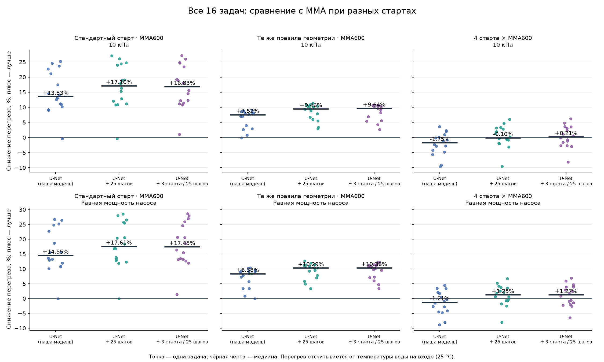
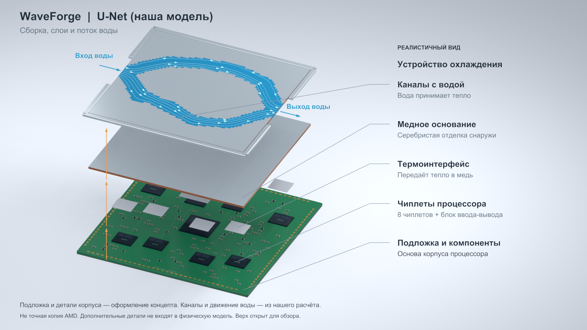

# WaveForge

### Нейросетевое проектирование теплоотводящих структур

[Русский](#russian) · [English](#english) · [Модели / Models](models/) · [Результаты / Results](results/stage55_20261029/)

<a id="russian"></a>

## Русский

WaveForge проектирует каналы для воды внутри медной охлаждающей пластины над процессором. Ищем такое расположение каналов, при котором самый горячий участок кремния нагревается меньше. Доля каналов и ограничения на работу насоса фиксированы.

U-Net (наша модель) предлагает четыре конструкции для расположения чиплетов и их нагрузки. Физический расчёт проверяет каждую. Затем система может доработать предложенные варианты за 25 шагов оптимизации. Веса сети при этом остаются замороженными.


Синим показаны каналы с водой, светлым цветом — медь. Красные рамки обозначают чиплеты. Конструкция остаётся неподвижной после изготовления: адаптация здесь означает проектирование новой геометрии под новые условия работы.

### Как работает система

1. Задаём положение восьми вычислительных чиплетов, центрального I/O-чиплета и три сценария нагрева.
2. Рассчитываем температуру и чувствительность к изменению каналов на исходной схеме Uniform-Parallel. Вместе с мощностью, масками и координатами эти поля образуют 13 входных каналов сети.
3. Сеть предсказывает четыре набора траекторий, ширин и локальных поправок. Геометрический декодер строит пять ветвей с общими боковыми коллекторами. Он сохраняет связность, медные промежутки между ветвями и ровно 1024 клетки каналов.
4. Проверяем поток и температуру на сетках 64 × 64 и 128 × 128. Выбираем конструкцию, которая проходит ограничения при одинаковом давлении и при одинаковой мощности насоса.

Декодер задаёт семейство допустимых каналов, а сеть подбирает их параметры под задачу. Полностью произвольную топологию она не строит.

Для доработки доступны два режима. `r25` делает 25 шагов из одного выбранного варианта. `multi25` берёт три лучших начальных варианта, делает по восемь шагов для каждого и ещё один шаг для лидера: **8 + 8 + 8 + 1 = 25**. Система сохраняет лучший допустимый результат, включая начальные конструкции.

Это число шагов оптимизатора, а не общее число физических расчётов. Подготовка входных полей, проверка кандидатов и расчёты на двух сетках тоже требуют времени.

### Что моделируем

| Параметр | Значение |
|---|---|
| Размер пластины | 75,4 × 72 мм |
| Источники тепла | 8 вычислительных чиплетов и 1 I/O-чиплет |
| Нагрузка | 3 сценария, по 360 Вт каждый |
| Слои | Кремний, термоинтерфейс, медное основание, слой каналов |
| Доля каналов | 25% площади проектируемого слоя; остальное занимает медь |
| Сетка конструкции | 64 × 64; итоговая оценка на 128 × 128 |
| Вода на входе | 25 °C |
| Номинальный перепад давления | 10 кПа |
| Второй режим сравнения | Одинаковая гидравлическая мощность насоса: 0,110901 Вт |

Поток описывает усреднённая модель Дарси, а теплообмен с водой задаёт модельный коэффициент. Гидравлическая ширина 280 мкм является параметром этой модели; одна клетка расчётной сетки не равна одному изготовленному микроканалу. Полные настройки и ограничения находятся в [methodology.json](results/stage55_20261029/methodology.json).

### Последний результат

Ниже показана система в режиме `multi25`. В каждом семействе эталонов она сравнивается с лучшим из Adam и MMA. Для каждой конструкции берём максимальную температуру по всем трём сценариям нагрева. Проценты обозначают медианное снижение этого перегрева относительно воды на входе. Плюс означает лучший результат WaveForge.

| Эталон | 10 кПа | Побед | Равная мощность насоса | Побед |
|---|---:|---:|---:|---:|
| Стандартный старт Uniform-Parallel, прежний декодер, 600 шагов на метод | **+10,57%** | 16/16 | **+11,25%** | 16/16 |
| Те же новые правила геометрии: оценка четырёх стартов, затем один запуск на 600 шагов | +1,64% | 12/16 | +2,91% | 13/16 |
| 4 старта с привязкой к чиплетам, предыдущие правила геометрии, по 600 шагов на старт | −1,87% | 1/16 | −1,28% | 2/16 |

Без локальной доработки замороженная сеть даёт +8,70% при 10 кПа и +8,49% при равной мощности насоса относительно стандартного старта. Побед соответственно 14 и 15 из 16.

Большой выигрыш над стандартным стартом включает вклад новой геометрии. Когда классические методы получают те же правила построения каналов, разница становится меньше. Эталон с четырьмя длинными запусками пока лучше нашей системы по медиане.

**Все 16 задач открытые и использовались при разработке. Это ещё не результат на закрытой тестовой выборке.** Для каждого метода одна и та же выбранная конструкция проходит оба режима работы насоса; подмена каналов между режимами не допускается. Сетка 128 × 128 участвует в отборе кандидатов.



Числа можно проверить по [полной таблице](results/stage55_20261029/comparison.csv), [сводным метрикам](results/stage55_20261029/metrics.json) и [сохранённым конструкциям с физическими полями](results/stage55_20261029/designs/). Процент рассчитывается так:

```text
перегрев = максимальная температура кремния − температура воды на входе
выигрыш, % = 100 × (перегрев эталона − перегрев WaveForge) / перегрев эталона
```

### Как обучали модель

Сеть учится через дифференцируемый физический решатель. Для её конструкций программа рассчитывает температуру и поток, затем передаёт производные ошибки в сеть. Заранее оптимизированные конструкции Adam/MMA в качестве правильных ответов не используются. Входные карты чувствительности получают из исходной схемы, до поиска новой конструкции.

Последний прогон включал 300 обновлений весов с четырьмя задачами в каждом, то есть 1200 предъявлений задач. Общую часть сети перенесли из предыдущего прогона, а выходные головы обучали заново. Это не полная стоимость обучения с нуля. Перед сравнением веса заморозили.

Текущий чекпойнт: [manifold_unet_ribbed.pt](models/manifold_unet_ribbed.pt). В [каталоге моделей](models/index.json) указаны архитектуры и контрольные суммы. Рядом лежат переносимые версии TorchScript; они возвращают параметры четырёх кандидатов. Для получения готовых каналов нужны геометрический декодер и физический отбор.

### Запуск

Нужен Python 3.11. Пример ниже работает на CPU и не переобучает сеть.

```powershell
git clone https://github.com/Lyamon4/waveforge-thermal.git
cd waveforge-thermal
py -3.11 -m venv .venv
.\.venv\Scripts\python.exe -m pip install -e ".[dev]"
.\.venv\Scripts\python.exe examples/evaluate_pretrained_ribbed.py --task 0 --mode r0 --output artifacts/example_r0
```

В Linux и macOS окружение создаётся командой `python3.11 -m venv .venv`; путь к интерпретатору внутри него: `.venv/bin/python`.

Для системы с доработкой:

```sh
python examples/evaluate_pretrained_ribbed.py --task 0 --mode multi25 --output artifacts/example_multi25
```

В этой команде `python` должен указывать на созданное окружение. Режимы: `r0`, `r25`, `multi25`. Индексы открытых задач: `0..15`. Параметр `--device cuda` переносит вычисления сети на NVIDIA GPU при установленной сборке PyTorch с CUDA; физические решатели этого примера работают на CPU.

Программа сохранит `result.json` и `selected.npz` с картой каналов, температурой, давлением и расходами через грани. Запуск тестов в том же окружении:

```sh
python -m pytest -q
```

### Видео и 3D

[Разделение на слои и охлаждение](media/videos/cooling_layers.mp4) · [Сборка процессора и движение воды](media/videos/realistic_assembly.mp4) · [Редактируемые сцены Blender](media/blender/)



Видео иллюстрируют более раннюю рассчитанную конструкцию. Движение частиц показывает направление потока на стационарном температурном поле. Корпус и разнесённые слои нужны для объяснения сборки; это не точный заводской CAD процессора.

### Где лежат файлы

| Папка | Содержимое |
|---|---|
| [`src/waveforge/lab/mcl/`](src/waveforge/lab/mcl/) | Модель потока и теплообмена, сеть, декодеры и оптимизация |
| [`examples/`](examples/) | Запуск сохранённых моделей |
| [`models/`](models/) | Замороженные веса и версии TorchScript |
| [`results/stage55_20261029/`](results/stage55_20261029/) | Последнее сравнение: 16 задач, 144 конструкции, 288 строк таблицы |
| [`media/`](media/) | Иллюстрации, видео и 3D-сцены |
| [`tests/`](tests/) | Проверки физики, производных и построения каналов |

WaveForge пока проверен в редуцированной расчётной модели. Измерений на изготовленной пластине и подтверждённого сравнения с промышленными водоблоками нет. Полное ускорение по времени, включая подготовку входов и все проверки, тоже ещё не измерено.

---

<a id="english"></a>

## English

### Neural design of heat-removal structures

WaveForge designs water channels inside a copper cooling plate above a processor. The goal is to reduce the temperature of the hottest silicon region while keeping the channel area and pump constraints fixed.

U-Net (our model) proposes four designs for a given chiplet layout and workload. A physics solver evaluates them. The system can then refine the candidates with 25 optimization steps while keeping the network weights frozen.

The blue regions in the figures are water channels; the light regions are copper. Red outlines mark the chiplets. The manufactured channels stay fixed. Adaptation means designing a new geometry for different operating conditions.

### How it works

1. Specify eight compute chiplets, a central I/O chiplet and three power scenarios.
2. Compute temperature and design-sensitivity fields for the initial Uniform-Parallel layout. These fields, power maps, masks and coordinates form the network's 13 input channels.
3. Predict four sets of channel paths, widths and local corrections. A geometric decoder constructs five branches connected to side headers. It preserves connectivity, copper gaps between branches and exactly 1024 channel cells.
4. Evaluate flow and temperature on 64 × 64 and 128 × 128 grids. Select a design that satisfies the constraints at both fixed pressure and equal pump power.

The decoder defines the allowed family of channels; the network chooses parameters for the task. It does not generate an unrestricted topology.

The `r25` mode takes 25 refinement steps from one selected candidate. The `multi25` mode refines three initial candidates for eight steps each, then gives the leading trajectory one more step: **8 + 8 + 8 + 1 = 25**. Selection retains the best admissible result, including the initial candidates.

These are optimizer steps, not the total number of physics solves. Input preparation, candidate scoring and checks on both grids add computational work.

### Physical model

| Parameter | Value |
|---|---|
| Plate size | 75.4 × 72 mm |
| Heat sources | 8 compute chiplets and 1 I/O chiplet |
| Workload | 3 scenarios, 360 W each |
| Stack | Silicon, thermal interface, copper base, channel layer |
| Channel budget | 25% of the design-layer area; the remaining area is copper |
| Design grid | 64 × 64; final evaluation on 128 × 128 |
| Inlet water temperature | 25 °C |
| Nominal pressure drop | 10 kPa |
| Second operating regime | Equal hydraulic pump power: 0.110901 W |

Flow follows a depth-averaged Darcy model with a prescribed heat-transfer coefficient. The hydraulic width of 280 µm is a model parameter; one grid cell does not represent one manufactured microchannel. [methodology.json](results/stage55_20261029/methodology.json) contains the full settings and admission limits.

### Latest results

The table reports `multi25` against the better of Adam and MMA within each baseline family. Each design is scored by its highest silicon temperature across all three power scenarios. Gains are median reductions in that temperature rise above inlet water. Positive values favor WaveForge.

| Baseline | 10 kPa | Wins | Equal pump power | Wins |
|---|---:|---:|---:|---:|
| Standard Uniform-Parallel start, previous decoder, 600 steps per optimizer | **+10.57%** | 16/16 | **+11.25%** | 16/16 |
| Same new geometric rules: score four starts, then one 600-step run | +1.64% | 12/16 | +2.91% | 13/16 |
| 4 chiplet-anchored starts with previous geometric rules, 600 steps per start | −1.87% | 1/16 | −1.28% | 2/16 |

Without local refinement, the frozen network achieves +8.70% at 10 kPa and +8.49% at equal pump power against the standard start, with 14/16 and 15/16 wins respectively.

The larger gain over the standard start includes the effect of the new geometric representation. The advantage is smaller when classical optimizers receive the same geometric rules. The reference with four long runs still performs better in median temperature rise.

**All 16 cases are open development cases used during method development. They are not a blind test set.** Each method uses the same selected design in both pump regimes. The 128 × 128 grid participates in candidate selection.

See the [comparison figure](results/stage55_20261029/figures/06_ФИНАЛЬНОЕ_СРАВНЕНИЕ.png), [full table](results/stage55_20261029/comparison.csv), [metrics](results/stage55_20261029/metrics.json) and [saved designs with physical fields](results/stage55_20261029/designs/).

```text
temperature rise = peak silicon temperature − inlet water temperature
gain, % = 100 × (baseline temperature rise − WaveForge temperature rise)
          / baseline temperature rise
```

### Training

The network learns through a differentiable physics solver. The solver evaluates temperature and flow, then returns loss derivatives to the network. Optimized Adam/MMA designs are not used as target answers. Input sensitivity maps come from the initial layout before searching for a new design.

The latest run used 300 updates with four tasks per update, or 1200 task exposures. It reused the shared network backbone from an earlier run and reset the output heads. This is not the total cost of training from scratch. Weights were frozen before comparison.

The current checkpoint is [manifold_unet_ribbed.pt](models/manifold_unet_ribbed.pt). The [model index](models/index.json) records architectures and checksums. Portable TorchScript versions return parameter vectors for four candidates; geometric decoding and physics-based scoring are still required to obtain a selected channel layout.

### Run a saved model

Use Python 3.11. After cloning the repository, create a virtual environment:

```sh
git clone https://github.com/Lyamon4/waveforge-thermal.git
cd waveforge-thermal
python3.11 -m venv .venv
.venv/bin/python -m pip install -e ".[dev]"
.venv/bin/python examples/evaluate_pretrained_ribbed.py --task 0 --mode r0 --output artifacts/example_r0
```

On Windows, use `py -3.11 -m venv .venv` and `.venv\Scripts\python.exe` instead. To run refinement in the active environment:

```sh
python examples/evaluate_pretrained_ribbed.py --task 0 --mode multi25 --output artifacts/example_multi25
python -m pytest -q
```

Available modes are `r0`, `r25` and `multi25`; open case indices are `0..15`. With a CUDA-enabled PyTorch installation, `--device cuda` runs the network on an NVIDIA GPU. This example's physical solvers run on the CPU. It does not train the network weights.

The output includes `result.json` and `selected.npz` with the channel mask, temperature, pressure and face flow rates.

### Videos and files

[Exploded layers and cooling](media/videos/cooling_layers.mp4) · [Processor assembly and water flow](media/videos/realistic_assembly.mp4) · [Editable Blender scenes](media/blender/)

The videos illustrate an earlier computed design. Moving particles show flow direction over a steady temperature field. The package and exploded layers explain the assembly; they are not an exact manufacturer's processor CAD model.

| Directory | Contents |
|---|---|
| [`src/waveforge/lab/mcl/`](src/waveforge/lab/mcl/) | Flow and thermal model, network, geometric decoders and optimization |
| [`examples/`](examples/) | Saved-model entry points |
| [`models/`](models/) | Frozen checkpoints and TorchScript exports |
| [`results/stage55_20261029/`](results/stage55_20261029/) | Latest comparison: 16 cases, 144 designs, 288 table rows |
| [`media/`](media/) | Figures, videos and 3D scenes |
| [`tests/`](tests/) | Physics, derivative and channel-construction checks |

The current evidence comes from the reduced simulation model. It does not include measurements on a manufactured plate or a demonstrated advantage over commercial cold plates. Complete-system wall-time speedup, including input preparation and all checks, has not been measured.
